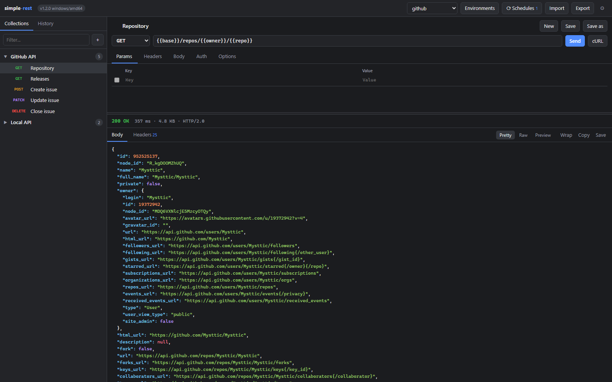
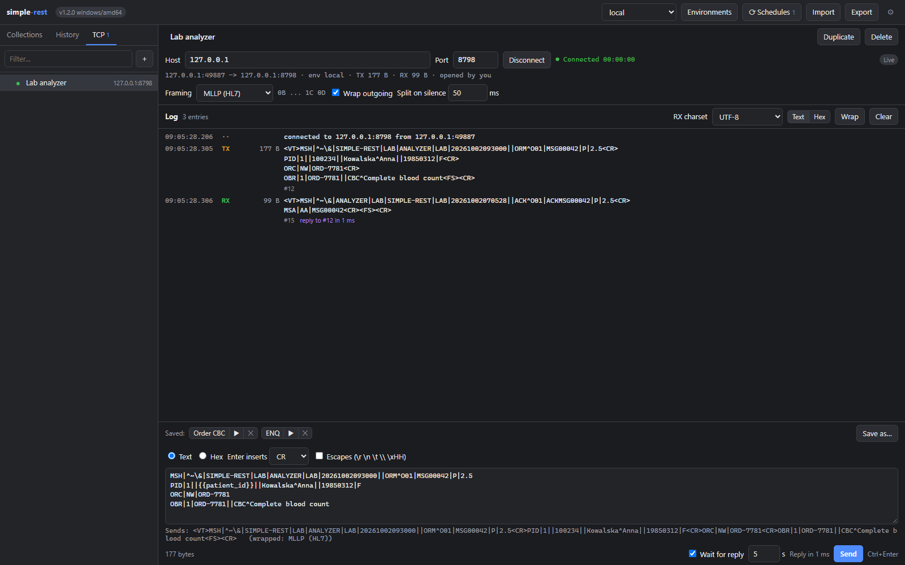

# simple-rest

Minimalny klient REST i TCP w stylu Postmana: jeden plik binarny, bez instalacji, bez
logowania, bez zależności. Interfejs działa w przeglądarce, ale zapytania HTTP i połączenia
TCP wykonuje sam program, więc nie obowiązują ograniczenia CORS przeglądarki, a konsola TCP
może rozmawiać z urządzeniem po surowym gnieździe, czego przeglądarka nie umie.



## Uruchomienie

Program otwiera przeglądarkę pod adresem `http://127.0.0.1:8787/`. Jedno wydanie to trzy
pliki, po jednym na system, plus sumy kontrolne.

| System | Plik | Jak |
|---|---|---|
| Windows x64 | `simple-rest-<wersja>-windows-amd64.exe` | dwuklik lub z konsoli |
| Linux x64 | `simple-rest-<wersja>-linux-amd64` | `chmod +x plik && ./plik` |
| Raspberry Pi (system 64-bit) | `simple-rest-<wersja>-linux-arm64` | jak wyżej |

Z innego urządzenia w sieci (telefon, tablet, druga maszyna) wystarczy uruchomić program
z `-listen 0.0.0.0:8787` i wejść na `http://<ip-maszyny>:8787/`. Interfejs jest zwykłą
stroną, więc działa na każdym systemie z przeglądarką, także tam, gdzie nie ma binarki.
Zamiast adresu IP można podać nazwę lokalną: nazwę bez kropki (`http://raspberrypi:8787/`),
nazwę z końcówką `.local`, `.lan`, `.home`, `.home.arpa`, `.internal` albo `.localdomain`
lub nazwę komputera, którą zwraca system. Inną nazwę, np. `pc123.firma.pl` z firmowego DNS,
trzeba dopisać flagą `-allow-host pc123.firma.pl` (patrz „Bezpieczeństwo”).

Zapytania wysyła program, harmonogramy działają w nim i to on otwiera połączenia TCP, więc
wszystko dzieje się na maszynie z binarką, np. na Raspberry Pi. Serwer docelowy i urządzenie
TCP muszą być osiągalne z tej maszyny, a nie z komputera, na którym jest przeglądarka.
Konsola TCP działa tak samo z innego komputera w sieci: połączenia są wspólne dla wszystkich
kart i komputerów (patrz „Konsola TCP”). Wersje linuksowe są budowane bez CGO i nie
rozwiązują nazw `.local` (mDNS): na Linuksie i Raspberry Pi podaj adres IP albo nazwę
z DNS sieci. Na Windows nazwy `.local` działają tak jak w systemie.

Inne systemy (macOS, Windows na ARM, 32-bitowe Raspberry Pi) nie mają gotowego pliku, ale
budują się jedną komendą, patrz „Budowanie”. Taka kopia mówi w ustawieniach, że nie ma dla
niej pliku wydania, i nie próbuje się aktualizować.

Flagi:

```
-listen 127.0.0.1:8787   adres nasłuchu (0.0.0.0:8787 udostępnia UI w sieci lokalnej)
-allow-host <nazwy>      dodatkowe nazwy hosta, pod którymi wolno otworzyć UI przy nasłuchu
                         poza 127.0.0.1, po przecinku; "*" przyjmuje każdą nazwę
-data <plik>             plik z danymi (domyślnie simple-rest-data.json obok binarki)
-no-browser              nie otwieraj przeglądarki automatycznie
-version                 wypisz wersję i zakończ
-update-url <adres>      skąd updater pobiera listę wydań (tylko do testów)
```

Jeśli port 8787 jest zajęty, program wybiera losowy wolny port i wypisuje adres w konsoli.

## Funkcje

- Metody GET, POST, PUT, PATCH, DELETE, HEAD, OPTIONS.
- Params (synchronizowane z URL w obie strony), Headers, Body (raw JSON/text/XML/HTML/JS
  albo x-www-form-urlencoded), Auth (Basic, Bearer, API key w nagłówku lub query).
- Opcje per zapytanie: timeout, podążanie za przekierowaniami, weryfikacja TLS, cookie jar.
- Odpowiedź: status, czas, rozmiar, protokół, nagłówki, podgląd JSON z kolorowaniem,
  widok raw, podgląd HTML/obrazków, kopiowanie i zapis body do pliku.
- Kolekcje z zapisanymi zapytaniami, historia (200 ostatnich), środowiska ze zmiennymi
  `{{nazwa}}` podstawianymi w URL, params, nagłówkach, body i auth.
- Harmonogramy: program co zadany czas wysyła zapisane zapytanie, np. logowanie, i ustawia
  zmienną, np. `{{token}}`, wartością z odpowiedzi (patrz „Harmonogramy”).
- Konsola TCP: program łączy się z urządzeniem albo systemem w sieci, wysyła komunikaty
  z `{{zmiennymi}}` (tekst z escape'ami albo hex), dzieli odbiór na komunikaty według
  ramkowania (None, LF, CR LF, MLLP, STX/ETX) i mierzy czas odpowiedzi (patrz „Konsola TCP”).
- Import/Export do JSON, razem z definicjami harmonogramów (bez ustawionych wartości)
  i połączeń TCP z zapisanymi komunikatami (bez logu).
  Import rozumie też Postman Collection v2.1 i Postman Environment.
  Zapytanie z Postmana bez własnego auth (albo z `inherit`) dostaje auth najbliższego
  folderu, a potem kolekcji; `noauth` znaczy brak auth. Zmienne kolekcji trafiają do
  nowego środowiska `<nazwa kolekcji> variables`. OAuth 2.0 i skrypty pre-request nie są
  importowane, a powiadomienie po imporcie podaje liczbę takich zapytań. Sekcje pliku
  z nowszej wersji simple-rest, których ta wersja nie zna, są pomijane i wymienione
  w powiadomieniu.
- Kopiowanie zapytania jako polecenie `curl`.
- Skróty: Enter w polu URL lub Ctrl+Enter wysyła, Ctrl+S zapisuje. W konsoli TCP Ctrl+Enter
  wysyła komunikat z edytora, a Ctrl+S zapisuje go pod nazwą przy połączeniu (Save as…).

## Harmonogramy

Harmonogram (kanał cykliczny) to zapisane zapytanie, które program wysyła co zadany czas,
żeby wyciągnąć z odpowiedzi wartość, zwykle token, i ustawić nią zmienną w wybranym
środowisku. Przycisk Schedules na górnym pasku otwiera okno harmonogramów i pokazuje, ile
z nich jest włączonych; czerwona ramka znaczy, że któryś stoi, a `?`, że program nie
odpowiada.


- **+ Schedule** bierze zapytanie otwarte w edytorze, o ile jest zapisane w kolekcji. To samo
  robi przycisk ⟳ przy zapytaniu na pasku bocznym, a znacznik ⟳ pokazuje zapytania, które
  wysyła włączony harmonogram. Nowy harmonogram jest wyłączony: najpierw sprawdź reguły
  przyciskiem Run now, potem zaznacz Enabled.
- **Every** to odstęp między przebiegami, od 10 sekund do doby. **Expiry** to ścieżka JSON
  do czasu ważności w sekundach (np. `expires_in`): program odświeża wartość tyle sekund
  przed jej wygaśnięciem, ile podasz, ale nie rzadziej niż co Every. Puste pole zostawia
  samo Every.
- **Set from the response** to reguły: ścieżka JSON (`access_token`, `data.items[0].token`,
  opcjonalnie z `$.`), nazwa nagłówka albo wyrażenie regularne w składni Go (RE2, bez
  lookbehind i odwołań wstecznych; wartość to pierwsza grupa). Reguła z Opt może nic nie
  znaleźć. Gdy reguła wymagana nic nie znajdzie, przebieg nie ustawia niczego.
- Wartość trafia do nakładki w pamięci programu. W swoim środowisku wygrywa z tabelą, także
  z wyłączonym wierszem, i działa także dla nazwy, której w tabeli nie ma. Okno Environments
  pokazuje ją pod tabelą z przyciskami Copy i Clear. Zapytania widzą ją tylko w karcie, która
  ma wybrane to środowisko.
- Przed Send i przed cURL karta zapisuje zmiany i prosi program o świeże wartości zmiennych,
  których używa zapytanie (najwyżej 25 sekund). Gdy wartość może być stara albo jej brak, bo
  harmonogram jest wyłączony, stoi albo się nie udał, powiadomienie mówi to wprost, a zapytanie
  i tak wychodzi.
- Odrzucone logowanie (401, 403), przekierowanie i inna odpowiedź 4xx zatrzymują harmonogram
  po pierwszej próbie, żeby nie zablokować konta. 5xx, 408 i 429 są ponawiane coraz rzadziej,
  a piąta porażka z rzędu też zatrzymuje harmonogram. Run now po poprawce zdejmuje
  zatrzymanie.
- Harmonogram wysyła wersję zapytania zapisaną w kolekcji, a nie niezapisane zmiany z edytora.
- Harmonogramy działają w programie, także bez otwartej karty, ale tylko dopóki program
  działa. Każdy start programu, także po aktualizacji, wyłącza wszystkie harmonogramy
  i czyści nakładkę, a wartości nigdy nie trafiają do pliku danych, eksportu ani historii.

## Konsola TCP

Konsola TCP (zakładka TCP na pasku bocznym) utrzymuje połączenie TCP z urządzeniem albo
systemem w sieci, np. z analizatorem laboratoryjnym, wysyła komunikaty i pokazuje, co
przychodzi. Program działa tylko jako klient: łączy się z podanym hostem i portem, nigdy
nie nasłuchuje. Licznik na zakładce pokazuje otwarte połączenia.



- **Połączenie** to definicja w pliku danych: nazwa, Host i Port (oba mogą zawierać
  `{{zmienne}}`, np. `{{lab_host}}`), ramkowanie i ustawienia edytora. Host to nazwa, adres
  IPv4 albo IPv6 (w nawiasach albo bez, także ze strefą, np. `fe80::1%eth0`). Wklejone
  `tcp://10.0.0.5:2575` albo `10.0.0.5:2575` rozdziela się na host i port. Connect jest
  zablokowany, dopóki zmienna hosta lub portu nie ma wartości albo port nie jest liczbą od 1
  do 65535.
- **Środowisko połączenia.** Connect bierze środowisko wybrane w tej karcie i połączenie
  zostaje przy nim do rozłączenia: zmienne w komunikatach podstawia program z tego
  środowiska (wiersze z pliku i nad nimi wartości z harmonogramów), niezależnie od tego,
  kto wysyła i jakie środowisko ma jego karta. Karta z innym środowiskiem widzi podpowiedź,
  a zmiana środowiska połączenia wymaga Disconnect i Connect. Przed Connect i przed Send
  karta zapisuje swoje zmiany i prosi program o świeże wartości z harmonogramów, tak jak
  przed Send HTTP.
- **Ramkowanie** (Framing): None (domyślne, surowe bajty), LF, CR LF, MLLP (HL7, `0B` ...
  `1C 0D`) i STX/ETX (`02` ... `03`). Wrap outgoing dokłada ramkę do wysyłanego komunikatu,
  chyba że komunikat już ją ma. Odbiór jest dzielony na komunikaty według ramki, a bajty
  spoza ramki (np. ACK albo NAK) trafiają do logu osobno, z dopiskiem `outside frame`.
  Split on silence (przy None, MLLP i STX/ETX) zamyka taki wpis po zadanej ciszy
  w milisekundach; 0 daje jeden wpis na każdy odczyt. Niedomknięta ramka czeka na swój
  koniec bez względu na ciszę, a ramka ponad 1 MB jest ucinana. Zmiana ramkowania przy
  otwartym połączeniu działa po Reconnect.
- **Edytor komunikatu.** W trybie Text komunikat idzie jako UTF-8, Enter wstawia wybrany
  koniec linii (LF, CR albo CR LF; HL7 używa CR), a przy włączonych Escapes `\r`, `\n`, `\t`,
  `\\` i `\xHH` dają swoje bajty (`\xHH` dokładnie jeden bajt). Każdy inny ukośnik, np. `\&`
  w nagłówku HL7, zostaje bez zmian. W trybie Hex komunikat to cyfry szesnastkowe, a odstępy
  i nowe linie nie mają znaczenia. `{{zmienna}}` działa w obu trybach. Linia `Sends:`
  pokazuje bajty, które pójdą na kabel, ze zmiennymi środowiska połączenia i z ramką;
  zmienna bez wartości idzie dosłownie jako `{{nazwa}}`. Komunikat może mieć najwyżej 1 MB.
- **Zapisane komunikaty.** Save as… (Ctrl+S) zapisuje komunikat z edytora przy połączeniu,
  w pliku danych. Przycisk z nazwą wkłada go do edytora, a ▶ od razu wysyła. Bieżący tekst
  edytora jest szkicem tej przeglądarki (localStorage) i nie trafia do pliku.
- **Wait for reply** czeka na odpowiedź: jest nią pierwszy wpis, który zaczął przychodzić
  po wysłaniu. Wynik to `Reply in 59 ms`, `No reply within 5 s` albo
  `Connection closed while waiting`. W trakcie czekania nikt nie wyśle do tego połączenia
  kolejnego komunikatu, a Cancel kończy czekanie. Czekanie nie trzyma połączenia HTTP
  przeglądarki.
- **Log** pokazuje wysłane (TX) i odebrane (RX) komunikaty z czasem, rozmiarem i numerem,
  jako tekst z nazwami znaków sterujących (`<VT>`, `<CR>`, `<FS>`) albo jako hex. RX charset
  wybiera kodowanie, w którym widać odbiór (UTF-8, Windows-1250, ISO-8859-2, Latin-1). Wpis
  ma przyciski Copy, Copy escaped i To editor; ten ostatni wkłada do edytora szablon
  wysłanego komunikatu albo jego bajty bez ramki. Czasy pochodzą z zegara maszyny
  z binarką. Log trzyma najwyżej 1000 wpisów albo 2 MB na połączenie i tylko w pamięci
  programu: nie trafia do pliku, historii ani eksportu, a Clear czyści go dla wszystkich.
- **Wspólne połączenia.** Połączenia żyją w programie i są wspólne dla wszystkich kart
  i komputerów: każdy widzi ten sam log, a wpis wysłany z innego komputera ma dopisek
  `by <adres>`. Połączenie zostaje otwarte po zamknięciu kart, dopóki ktoś nie da
  Disconnect, więc urządzenie przyjmujące jednego klienta jest do tego czasu zajęte. Connect
  przy otwartym połączeniu kończy się komunikatem `Already connected (another tab or
  computer?)`.
- Martwe urządzenie bez ruchu wykrywa keepalive po około 30 sekundach, a na Linuksie także
  przy danych w drodze (`TCP_USER_TIMEOUT`). Na Windows bardzo wolny odbiorca dużego
  komunikatu (powyżej około 400 KB, wolniej niż około 6 KB/s) może przerwać wysyłkę błędem
  `write timeout: no progress for 10 s`.
- Po każdym starcie programu, także po aktualizacji, żadne połączenie nie jest otwarte i nic
  nie łączy się samo. Wersje linuksowe nie rozwiązują nazw `.local` (mDNS): przy
  `no such host` konsola podpowiada, żeby podać adres IP.

Karta dostaje zmiany połączeń, logu, pliku danych i harmonogramów od razu, jednym
strumieniem zdarzeń (`GET /api/events`); znacznik Live w konsoli mówi, że strumień działa.
Karta w tle zamyka strumień, a po powrocie nadrabia zaległość. Bez strumienia, np. w czasie
restartu programu, karta odpytuje program co kilka sekund, a edytor pokazuje
`Live updates are off: values may be stale.`

## Aktualizacje z aplikacji

Ustawienia (ikona koła zębatego), sekcja Updates:

- **Check for updates** pyta publiczne repozytorium Mysttic/Mysttic o najnowsze wydanie
  z prefiksem `simple-rest-v`, porównuje numer z uruchomionym i pokazuje jeden z trzech
  stanów: jest nowsza wersja (karta z numerem, notatką i przyciskiem), to jest najnowsza
  wersja, albo nie udało się zapytać (problem z połączeniem, osobny komunikat).
- **Automatyczne sprawdzanie** jest domyślnie wyłączone. Po włączeniu program pyta raz
  na dobę (timer co godzinę, pytanie tylko gdy ostatnie było ponad 24 h temu; znacznik
  czasu zapisuje się także po nieudanej próbie). Przycisk działa niezależnie od tego
  ustawienia.
- **Install and restart** pobiera plik dla tej platformy do `.simple-rest-update/` obok
  binarki (najpierw jako `.part`), sprawdza rozmiar zadeklarowany w wydaniu i SHA-256
  z pliku `...-checksums.txt`, podmienia własny plik wykonywalny i uruchamia się ponownie
  na tym samym porcie, z tymi samymi argumentami. Strona w przeglądarce czeka na nową wersję
  i sama się przeładowuje. Jeśli nowa wersja odrzuca nazwę, pod którą otwarto stronę
  (reguła Host, patrz „Bezpieczeństwo”), strona z wersji 1.2.0 i nowszej mówi to wprost.
  Strona z wersji starszej niż 1.2.0 tego nie umie: kto przy nasłuchu poza 127.0.0.1
  otwiera UI pod nazwą spoza reguły, np. `pc123.firma.pl`, po aktualizacji do 1.2.0
  zobaczy po około 40 sekundach komunikat, że program nie wrócił, choć nowa wersja działa
  na tym samym porcie. Wtedy otwórz UI po adresie IP albo zatrzymaj program i uruchom go
  z `-allow-host pc123.firma.pl`. Nie uruchamiaj drugiej kopii obok działającej: port jest
  zajęty, więc wstałaby na losowym porcie, na tym samym pliku danych.
  Na Windows stary plik zostaje chwilowo jako `.exe.old` i jest usuwany przy starcie.
  Restart wyłącza wszystkie harmonogramy, czyści ich wartości i zamyka połączenia TCP, więc
  przy włączonych harmonogramach albo otwartych połączeniach przycisk najpierw pyta o zgodę.
  Inne otwarte karty po restarcie pokazują powiadomienie, że harmonogramy trzeba włączyć
  ponownie.
- Kopia, która nie może się zaktualizować (katalog bez prawa zapisu, uruchomienie przez
  `go run`, brak pliku wydania dla tego systemu), mówi to wprost i linkuje do strony
  pobierania.
- Stan updatera trzymany jest w `simple-rest-update.json` obok pliku danych.

Pełne przejście ścieżki na prawdziwej binarce (kopia 0.9.0, fałszywy hub, podmiana,
restart) uruchamia `sh scripts/e2e-update.sh`; to samo robi CI.

## Dane

Wszystko (kolekcje, historia, środowiska, ustawienia, definicje harmonogramów i połączeń
TCP) trafia do jednego pliku JSON obok binarki: `simple-rest-data.json`. Wystarczy przenieść
katalog, żeby przenieść dane. Aktualizacja nie dotyka tego pliku.

Z tym samym plikiem może pracować kilka kart naraz, także z innych komputerów przy
`-listen 0.0.0.0:8787`. Widoczna karta dostaje od programu znak, gdy plik się zmienił
(strumień zdarzeń, patrz „Konsola TCP”), a bez strumienia sprawdza plik co 10 sekund;
poza tym sprawdza go po powrocie do karty i po zamknięciu okna dialogowego. Nowszą wersję
wczytuje tylko wtedy, gdy sama nie ma niezapisanych zmian. Otwarte w edytorze zapytanie bez
niezapisanych zmian też się odświeża, a z niezapisanymi zmianami zostaje i pokazuje
różnicę względem nowej wersji. Konsola TCP też pokazuje definicję połączenia z pliku.

Każdy zapis idzie z nagłówkiem `If-Match`. Jeśli plik zmieniła w międzyczasie inna karta
albo inny komputer, program odrzuca zapis i plik zostaje bez zmian. Karta pokazuje wtedy
baner z przyciskiem Reload i do przeładowania niczego nie zapisuje, więc ostatnią zmianę
trzeba po przeładowaniu zrobić jeszcze raz. Strona otwarta z innej wersji programu (np.
karta sprzed aktualizacji) też niczego nie nadpisze. Strona z wersji 1.2.0 lub nowszej
pokazuje wtedy taki sam baner, a karta z wersji 1.1.0 lub starszej przy każdej próbie
zapisu pokazuje powiadomienie „Save failed” z prośbą o przeładowanie strony.

Wybór środowiska na górnym pasku dotyczy tylko bieżącej karty i przeżywa jej
przeładowanie. Plik pamięta ostatni wybór jako środowisko startowe nowej karty.

Definicje harmonogramów leżą w pliku pod kluczem `schedules`. To, czy harmonogram jest
włączony, kiedy ruszy, dlaczego stoi i jakie wartości ustawił, program trzyma tylko
w pamięci i nigdy nie zapisuje pliku danych sam.

Definicje połączeń TCP z zapisanymi komunikatami leżą w pliku pod kluczem `tcp`. Stan
połączeń i ich log są tylko w pamięci programu, a tekst edytora komunikatu jest szkicem
w przeglądarce (localStorage), osobno dla każdego połączenia. Uwaga: po cofnięciu do
wersji 1.1.0 pierwszy zapis z karty usuwa z pliku klucze `schedules` i `tcp`.

Pola, których ta wersja nie zna, na przykład dopisane przez nowszą wersję, przeżywają
zapis bez zmian.

## Budowanie

Potrzebny tylko Go (https://go.dev/dl/), bez CGO i bez zewnętrznych modułów. Numer
wersji jest wkompilowany z `VERSION.md`.

```
go build -ldflags "-s -w" -o simple-rest.exe .
```

Całe wydanie do `dist/` (trzy binarki i plik z sumami SHA-256):

```
sh build.sh        # Linux/macOS/Git Bash
build.cmd          # Windows cmd
```

Dla systemu spoza tej trójki wystarczy podać cel Go, na przykład macOS na Apple Silicon:

```
CGO_ENABLED=0 GOOS=darwin GOARCH=arm64 go build -ldflags "-s -w" -o simple-rest .
```

Kopia zgłaszająca inny numer, do testów updatera:
`go build -ldflags "-X main.versionOverride=0.9.0" -o simple-rest.exe .`

## Rozwój i testy

Gałęzie: `develop` (praca) i `master` (wydania). CI nie odpala się na `develop`, więc testy
uruchamiaj lokalnie (komendy niżej) albo ręcznie z zakładki Actions (`workflow_dispatch`);
automatycznie sprawdzany jest dopiero PR `develop` → `master`.

```
go test ./... -count=1                 # serwer, proxy, guard, updater (z fałszywym hubem), harmonogramy, TCP
go test -race ./... -count=1           # to samo z wykrywaniem wyścigów (potrzebny gcc); CI tego nie robi
node --test "tests/**/*.test.mjs"      # UI: params/URL, zmienne, auth, import Postman, cURL, zapis, harmonogramy, TCP
sh scripts/e2e-update.sh               # ścieżka aktualizacji end to end na prawdziwej binarce
node scripts/screenshots.mjs           # zrzuty do site/simple-rest/img/ (Edge albo Chrome)
```

Testy UI ładują skrypt z `ui.html` przez `tests/load-ui.mjs`, bez przeglądarki:
`tests/ui.test.mjs` sprawdza czyste funkcje, `tests/state.test.mjs` zapis i synchronizację
pliku danych, a `tests/schedules.test.mjs` okno harmonogramów, nakładkę i Send z odświeżaniem
wartości. Zapytanie harmonogramu buduje program w Go (`effective.go`), tak jak strona buduje
zapytanie przycisku Send. Wspólne wektory w `testdata/effective.json` uruchamiają
`effective_test.go` i `tests/effective.test.mjs`, więc obie strony budują to samo zapytanie
z tych samych danych. Zmiana jednej z tych funkcji wymaga zmiany jej odpowiednika i wektora.

`tests/tcp.test.mjs` sprawdza konsolę TCP: edytor komunikatu i bajty, które z niego
wychodzą, to, co karta trzyma ze zdarzeń programu, strumień zdarzeń z powrotem do
odpytywania oraz akcje konsoli. Ramkowanie i sprawdzanie hosta i portu mają odpowiedniki
w Go (`tcpframe.go`, `tcp.go`), a wspólne wektory w `testdata/tcp-framing.json` uruchamiają
`tcpframe_test.go` i `tests/tcp.test.mjs`. `tcp_linux_test.go` (`TCP_USER_TIMEOUT`) działa
tylko na Linuksie, więc z Windows uruchamia go dopiero CI na PR wydania albo Raspberry Pi.

`scripts/screenshots.mjs` buduje aplikację, uruchamia ją z przykładową kolekcją i drugą
kopią zgłaszającą starszą wersję, po czym robi zrzuty przez protokół DevTools. Fałszywy hub
oferuje wydanie o numerze z `VERSION.md` i wydaje token, który odświeża włączony przez
skrypt harmonogram. Dzięki temu obrazki na stronie są prawdziwe i odtwarzalne po każdej
zmianie interfejsu. Zrzut promo wysyła prawdziwe zapytanie do `api.github.com`, więc
skrypt potrzebuje sieci.

Workflow `CI` (`.github/workflows/ci.yml`) uruchamia to wszystko, razem z `gofmt` i
`go vet`, wyłącznie przy PR z `develop` do `master`. Push do `develop` i PR do `develop`
nie odpalają już nic; awaryjnie zostaje ręczne uruchomienie z zakładki Actions
(`workflow_dispatch`). PR do `master` z innej gałęzi niż `develop` pomija wszystkie joby,
więc GitHub pokaże taki przebieg jako zielony. To świadoma decyzja, a nie przeoczenie:
konto jest na limicie minut Actions. Build wszystkich platform (`sh build.sh`) zostaje w CI,
bo na runnerze linuksowym `go vet` i `go test` nie kompilują `restart_windows.go`, więc jest
to jedyny krok sprawdzający cele windows/amd64 i linux/arm64; zniknął tylko upload `dist/`
jako artefakt przebiegu. PR z `develop` dostaje dodatkowo job „Release preview” z informacją,
czy merge opublikuje wydanie.

W repozytorium nie ma już żadnego przebiegu cyklicznego ani sprzątania Actions storage.
Artefaktów przebiegów nie wysyła teraz nic, ale logi każdego przebiegu nadal liczą się do
wspólnego dla konta limitu storage. Jeśli limit się zapcha, czyści się go ręcznie:
z zakładki Actions albo `gh api -X DELETE /repos/Mysttic/simple-rest/actions/runs/<id>/logs`.

## Wydania

- `VERSION.md` trzyma numer wersji (jedna linia, `major.minor.patch`). Program wkompilowuje
  go przy budowaniu, więc binarka i tag zawsze się zgadzają.
- `CHANGELOG.md` opisuje zmiany w każdej wersji (format Keep a Changelog). Wydanie wymaga
  sekcji `## [x.y.z]` dla numeru z `VERSION.md`; jej treść staje się opisem release.
- Workflow `Release` (`.github/workflows/release.yml`) startuje po push do `master`, który
  zmienia `VERSION.md` (czyli po merge PR z `develop` z podbitym numerem); zmiana samego
  `CHANGELOG.md`, kodu lub workflowa przy niewydanym numerze (np. po nieudanym przebiegu)
  nie uruchamia nic i wymaga ręcznego „Run workflow” na `master`, i to tylko z `master`: z innej
  gałęzi workflow pomija wszystkie joby. Publikuje tylko wtedy, gdy `VERSION.md` jest wyższy od
  najnowszego tagu `v*`. Wtedy: testy, build, tag `v<wersja>` i release w tym repozytorium
  z plikami z `dist/`, a potem job `site` kopiuje te same pliki do Mysttic/Mysttic pod
  tagiem `simple-rest-v<wersja>` i usuwa tam starsze wydania projektu. Bez podniesienia
  `VERSION.md` merge nie publikuje nic. Obniżenie numeru zatrzymuje workflow z błędem.
  Pełnego CI tu nie ma: te same testy poszły już na PR `develop` → `master`, na tym
  samym drzewie.
  Zostaje krótki job `Tests` (`go test` i testy UI, ok. 2 min) przed buildem: `master` nie
  jest gałęzią chronioną, więc push prosto na `master` omija PR, a job `site` kasuje
  poprzednie wydanie ze strony bezpowrotnie i nie ma do czego wrócić.

Procedura wydania:

1. Na `develop`: podnieść `VERSION.md`, dopisać sekcję w `CHANGELOG.md`.
2. PR `develop` → `master`, poczekać na zielone CI i podgląd „Release preview”.
3. Merge. Release i kopia plików wydania na hub dzieją się same.
4. Gdy wydanie zmienia stronę projektu (opis, zrzuty), skopiować ją ręcznie na hub,
   patrz `site/README.md`.

Wymagany sekret: `HUB_TOKEN` w ustawieniach repozytorium (Settings, Secrets and variables,
Actions): fine-grained token dla właściciela `Mysttic`, dostęp tylko do `Mysttic/Mysttic`,
uprawnienie Contents: Read and write. Bez niego release w tym repozytorium powstanie, a job
`site` zakończy się czytelnym błędem.

Strona projektu na hubie leży gotowa w `site/simple-rest/`; jak ją podpiąć i odświeżać
opisuje `site/README.md`. Job `site` kopiuje na hub tylko pliki wydania, a nie treść
strony.

## Tryb bez binarki

`ui.html` otwarty bezpośrednio w przeglądarce też działa, ale wtedy
zapytania wysyła przeglądarka: serwer docelowy musi zezwalać na CORS, opcje TLS i cookies
są ignorowane, dane trzymane są w localStorage tej przeglądarki, a sekcja aktualizacji
jest ukryta. Harmonogramy działają tylko w programie: okno Schedules pokazuje definicje,
np. zaimportowane z pliku, ale tylko do odczytu, a Send nie pyta o świeże wartości.
Konsola TCP potrzebuje programu, bo przeglądarka nie otwiera surowych gniazd TCP: bez
niego zakładka TCP pokazuje definicje połączeń tylko do odczytu, z banerem. Podobnie strona
otwarta z innej wersji programu (np. karta sprzed aktualizacji) pokazuje harmonogramy
i konsolę TCP z banerem i bez akcji (Connect, Send i Disconnect też), dopóki jej nie
przeładujesz; Send HTTP działa dalej.

## Bezpieczeństwo

Domyślnie program nasłuchuje tylko na 127.0.0.1 i odrzuca żądania z obcym nagłówkiem
Host lub Origin (ochrona przed DNS rebinding i CSRF ze stron otwartych w tej samej
przeglądarce).

Przy nasłuchu poza 127.0.0.1 (np. `-listen 0.0.0.0:8787`) nagłówek Host musi być adresem
IP (także IPv6, również ze strefą), nazwą bez kropki, nazwą z końcówką, której nie da się
zarejestrować w publicznym DNS (`.local`, `.lan`, `.home`, `.home.arpa`, `.internal`,
`.localdomain`), nazwą komputera, którą zwraca system, albo jej pierwszym członem, albo
nazwą z `-allow-host`. Wielkość liter i kropka na końcu nazwy nie mają znaczenia. Dzięki
temu obca strona nie skieruje przez DNS rebinding swojej nazwy na ten komputer, żeby czytać
odpowiedzi programu.
Inna nazwa dostaje 403 z podpowiedzią, a konsola przy pierwszym odrzuceniu danej nazwy
podaje gotową flagę, np. `-allow-host pc123.firma.pl`. Nazwa ze znakami innymi niż litery,
cyfry, myślnik, podkreślnik i kropka gotowej flagi nie dostaje. `-allow-host "*"` wyłącza to
sprawdzanie, jak przed wersją 1.2.0, a program ostrzega o tym przy starcie. Gwiazdka
w cudzysłowie podwójnym działa w cmd, PowerShell i sh; w cmd apostrofy (`'*'`) trafiają do
programu razem z gwiazdką i sprawdzanie zostaje włączone. Przy nasłuchu na 127.0.0.1 flaga
nic nie zmienia.

Strony programu nie da się osadzić w ramce na innej stronie (`X-Frame-Options: DENY`
i `Content-Security-Policy: frame-ancestors 'none'`), więc obca strona nie podsunie
kliknięcia w Send, Enabled, Run now ani Install and restart.

Wersje linuksowe nie pytają o nazwy `.local` przez mDNS, tylko przez zwykły DNS sieci
(patrz „Uruchomienie”). Zwykle kończy się to błędem `no such host` z podpowiedzią, ale
serwer DNS, który zna taką nazwę, może wskazać inny komputer niż ten, który ogłasza ją
w sieci, i to tam pójdzie np. login harmonogramu z hasłem. Na Linuksie i Raspberry Pi
podawaj serwer tokenu i inne cele po adresie IP albo po nazwie z DNS sieci.

Program nie ma hasła. `-listen 0.0.0.0:8787` wystawia proxy HTTP bez uwierzytelniania na
całą sieć lokalną: każdy, kto dosięgnie programu, widzi i zmienia wszystko, co program
trzyma, czyli kolekcje, historię i środowiska razem z wartościami zmiennych (także haseł
i tokenów), wartości ustawione przez harmonogramy (`GET /api/schedules`) i log konsoli
TCP (np. dane pacjentów z analizatora), i wysyła zapytania z tej maszyny, także włącza
i wyłącza harmonogramy. Konsola TCP wysyła dowolne bajty pod dowolny host i port osiągalny
z maszyny z binarką, więc każdy w sieci może przez program rozmawiać z urządzeniami albo
skanować sieć. Używaj tego tylko w zaufanej sieci. Trasy `/api/tcp*` i strumień zdarzeń
`/api/events` przechodzą przez te same sprawdzenia Host i Origin co reszta. Sam z siebie
program łączy się tylko w dwóch przypadkach, i to dopiero po włączeniu: żeby sprawdzić
wydania i żeby wysłać zapytanie harmonogramu. Połączenie TCP otwiera wyłącznie Connect
z UI. Harmonogram włączony z innego komputera działa dalej po zamknięciu tamtej karty;
okno Schedules pokazuje, od kiedy jest włączony i z jakiego adresu. Tak samo połączenie
TCP zostaje otwarte po zamknięciu karty, a konsola pokazuje, z jakiego adresu je otwarto.

## Licencja

MIT, patrz [LICENSE](LICENSE).
