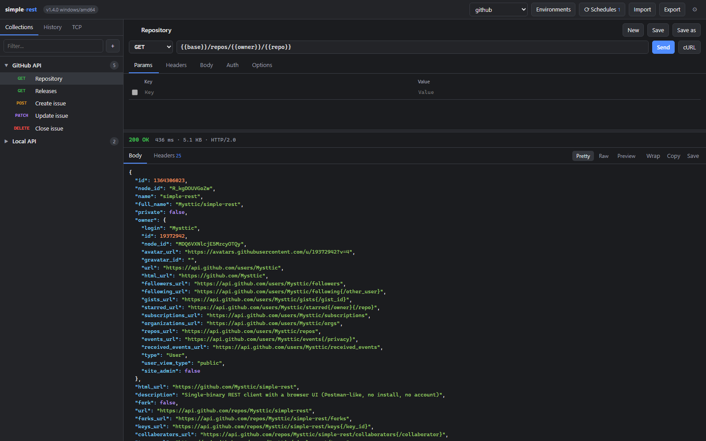
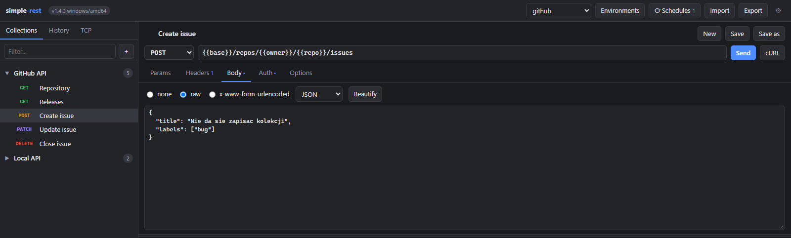
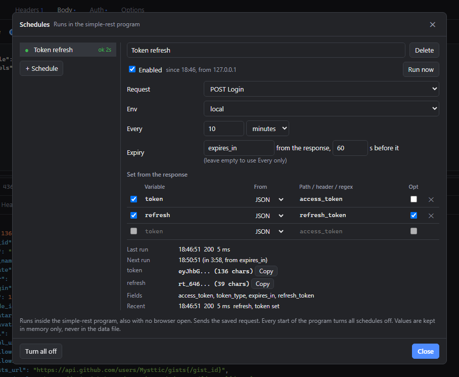
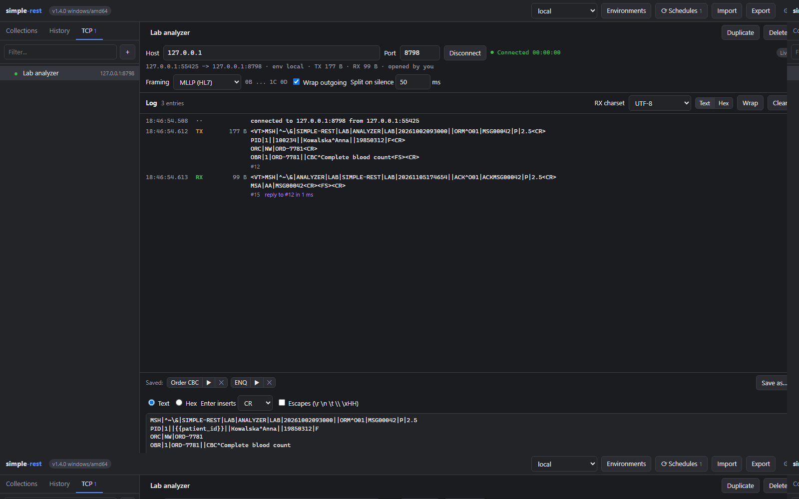
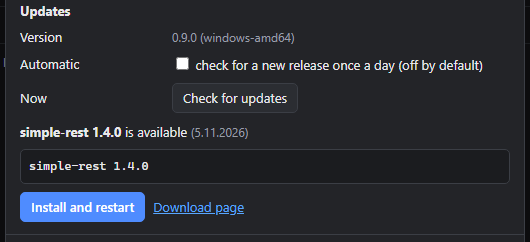

# simple-rest

**English** · [Polski](README.pl.md)

**A REST client that is one file.** Collections, environments, history and a response viewer,
like the big tools, without the installer, the account or the cloud. Schedules keep tokens
fresh, and a TCP console talks to devices on your network.

Download one file, run it, the browser opens. That is the whole setup.

## Download

Take the file for your system from the [latest release](https://github.com/Mysttic/simple-rest/releases/latest).
It opens the UI in your browser at `http://127.0.0.1:8787/`. Running 1.3.0 or older? Those copies
do not see newer releases in the app, so download the new file once, see
[Updates and data](docs/updates-and-data.md).

| System | File | Run |
|---|---|---|
| Windows x64 | `simple-rest-<version>-windows-amd64.exe` | double-click it, or start it from a console |
| Linux x64 | `simple-rest-<version>-linux-amd64` | `chmod +x file && ./file` |
| Raspberry Pi 3, 4 or 5 with a 64-bit system | `simple-rest-<version>-linux-arm64` | as on Linux |

`simple-rest-<version>-checksums.txt` holds the SHA-256 of each file. The files are not signed
with a certificate, so Windows SmartScreen shows "Windows protected your PC": choose "More
info", then "Run anyway". Other systems (macOS, Windows on ARM, a 32-bit Raspberry Pi) build
with one command, see [Building](CONTRIBUTING.md#building).

## What it does

- **No CORS in the way.** The page in your browser talks only to the program. The program sends
  the real request, so any API answers, with every header visible.
- **Requests, the usual way.** Every method, query parameters synced with the URL, headers, raw
  or form bodies, Basic, Bearer and API key auth, timeouts, redirects, TLS verification and a
  cookie jar.
- **Collections and environments.** Saved requests in collections, a history of what you sent,
  and `{{variables}}` from the active environment substituted in URL, headers, body and auth.
- **Schedules keep a token fresh.** The program sends a saved login request every few minutes,
  also with no browser open, and puts the token from the answer into `{{token}}`. Values stay
  in memory, and every start of the program turns the schedules off.
- **A TCP console for devices.** The program connects as a client to a device or system anywhere
  on your local network and keeps the connection open until you disconnect. Framing presets
  None, MLLP, STX/ETX, LF and CR LF, `{{variables}}` in messages, and Wait for reply that times
  the answer.
- **Reads what Postman exports.** Import a Postman Collection v2.1 or a Postman environment,
  export your own as JSON, copy any request as a `curl` command.
- **Responses you can read.** Status, time, size and protocol, headers, JSON with colours, raw
  text, an HTML or image preview, copy or save the body to a file.
- **Your data stays in one file.** Collections, history and environments live in a JSON file
  next to the program. Move the folder and everything comes along.

## How it looks

| | |
|---|---|
|  |  |
| Collections on the left, the request you are editing on the right | A schedule that logs in and keeps `{{token}}` fresh |
|  |  |
| The TCP console: an HL7 order over MLLP and the ACK it got back | A newer release, found and installed by the app |

## Privacy

- By default the program listens on 127.0.0.1 only and refuses requests that other websites in
  your browser send to it. It has no password: other programs on the same machine can use it,
  and once started with `-listen 0.0.0.0:8787` so can anyone on your network, who then sees
  your variables and the tokens your schedules set. Do that only on a network you trust.
- Nothing leaves on its own: no telemetry, no account, nothing collected. The app sends
  requests by itself only for what you turn on: the check for a newer release and the schedules
  you enable. Both start off.
- Updates you can verify: the updater checks the size and the SHA-256 of a new release against
  the published list, and only then swaps the file.

## Documentation

- [Using simple-rest](docs/usage.md): flags, the UI from another device, requests, import and
  shortcuts, the page without the program
- [Schedules](docs/schedules.md): refreshing a token or another value from an answer
- [TCP console](docs/tcp-console.md): connections, framing, the message editor and the log
- [Updates and data](docs/updates-and-data.md): the updater, the data file, several tabs and computers
- [Security](docs/security.md): Host rules, the network, what the program sends by itself
- [Contributing](CONTRIBUTING.md): building, tests, CI and releases

## License

MIT, see [LICENSE](LICENSE).
