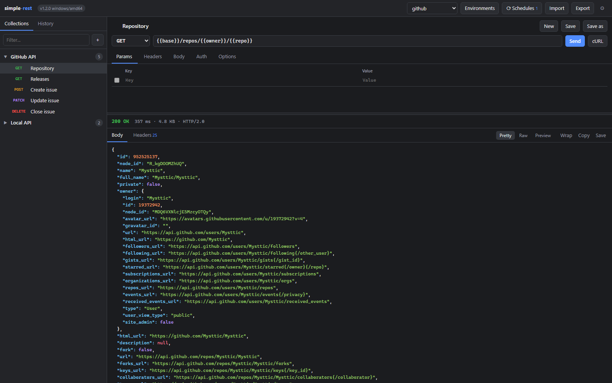
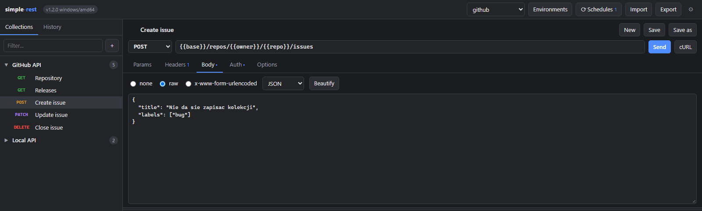
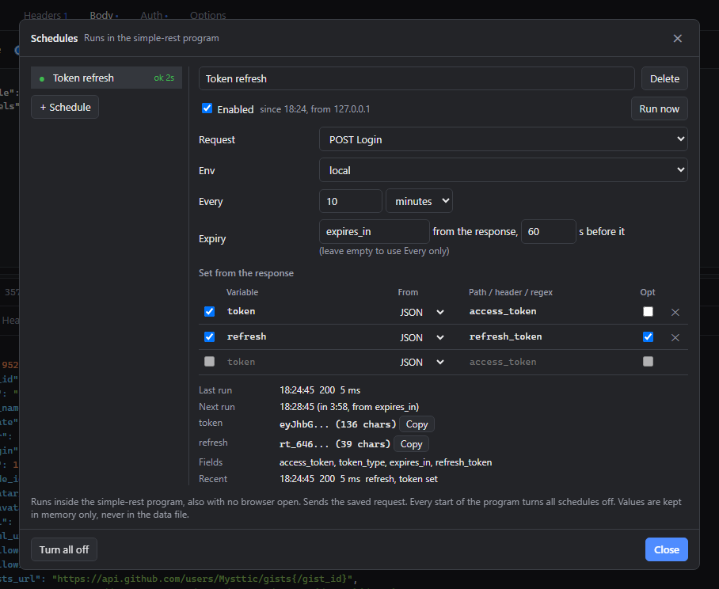
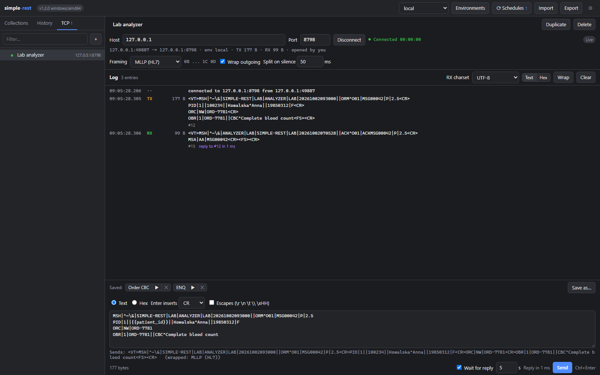
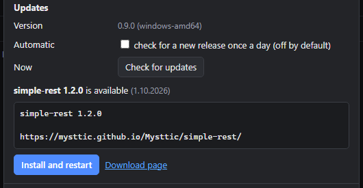

# simple-rest

[English](README.md) · **Polski**

**Klient REST, który jest jednym plikiem.** Kolekcje, środowiska, historia i podgląd odpowiedzi
jak w dużych narzędziach, tylko bez instalatora, konta i chmury. Harmonogramy odświeżają tokeny,
a konsola TCP rozmawia z urządzeniami w Twojej sieci.

Pobierz jeden plik, uruchom go, otworzy się przeglądarka. To cała instalacja.

## Pobieranie

Plik dla swojego systemu weź z [najnowszego wydania](https://github.com/Mysttic/simple-rest/releases/latest).
Program otwiera interfejs w przeglądarce pod adresem `http://127.0.0.1:8787/`.

| System | Plik | Uruchomienie |
|---|---|---|
| Windows x64 | `simple-rest-<wersja>-windows-amd64.exe` | dwuklik albo z konsoli |
| Linux x64 | `simple-rest-<wersja>-linux-amd64` | `chmod +x plik && ./plik` |
| Raspberry Pi 3, 4 lub 5 z systemem 64-bit | `simple-rest-<wersja>-linux-arm64` | jak na Linuksie |

`simple-rest-<wersja>-checksums.txt` zawiera sumy SHA-256 każdego pliku. Pliki nie są
podpisane certyfikatem, więc Windows SmartScreen pokaże „System Windows ochronił ten komputer”:
wybierz „Więcej informacji”, a potem „Uruchom mimo to”. Inne systemy (macOS, Windows na ARM,
Raspberry Pi z systemem 32-bit) budują się jedną komendą, patrz [Building](CONTRIBUTING.md#building).

## Co potrafi

- **CORS nie przeszkadza.** Strona w przeglądarce rozmawia tylko z programem. Prawdziwe
  zapytanie wysyła program, więc odpowie każde API, z wszystkimi nagłówkami na widoku.
- **Zapytania jak zwykle.** Wszystkie metody, parametry zsynchronizowane z URL, nagłówki, body
  raw albo formularz, auth Basic, Bearer i API key, timeout, przekierowania, weryfikacja TLS
  i cookie jar.
- **Kolekcje i środowiska.** Zapisane zapytania w kolekcjach, historia wysłanych zapytań
  i `{{zmienne}}` z aktywnego środowiska podstawiane w URL, nagłówkach, body i auth.
- **Harmonogramy odświeżają token.** Program co kilka minut wysyła zapisane zapytanie
  logowania, także bez otwartej przeglądarki, i wstawia token z odpowiedzi do `{{token}}`.
  Wartości zostają w pamięci, a każdy start programu wyłącza harmonogramy.
- **Konsola TCP do urządzeń.** Program łączy się jako klient z urządzeniem albo systemem
  w Twojej sieci lokalnej i trzyma połączenie, dopóki go nie rozłączysz. Ramkowanie None, MLLP,
  STX/ETX, LF i CR LF, `{{zmienne}}` w komunikatach i Wait for reply, które mierzy czas
  odpowiedzi.
- **Czyta eksport z Postmana.** Import Postman Collection v2.1 i środowisk Postmana, eksport
  własnych danych do JSON, kopiowanie każdego zapytania jako polecenie `curl`.
- **Czytelne odpowiedzi.** Status, czas, rozmiar i protokół, nagłówki, kolorowany JSON, surowy
  tekst, podgląd HTML i obrazków, kopiowanie i zapis body do pliku.
- **Dane w jednym pliku.** Kolekcje, historia i środowiska leżą w pliku JSON obok programu.
  Przenosisz katalog i wszystko idzie razem z nim.

## Jak wygląda

| | |
|---|---|
|  |  |
| Kolekcje po lewej, edytowane zapytanie po prawej | Harmonogram, który loguje się i odświeża `{{token}}` |
|  |  |
| Konsola TCP: zamówienie HL7 po MLLP i ACK, które przyszło w odpowiedzi | Nowsze wydanie znalezione i zainstalowane przez aplikację |

## Prywatność

- Domyślnie program nasłuchuje tylko na 127.0.0.1 i odrzuca zapytania, które wysyłają do niego
  inne strony otwarte w przeglądarce. Nie ma hasła: mogą z niego korzystać inne programy na tej
  samej maszynie, a po uruchomieniu z `-listen 0.0.0.0:8787` także każdy w Twojej sieci, który
  widzi wtedy Twoje zmienne i tokeny ustawione przez harmonogramy. Rób to tylko w sieci, której
  ufasz.
- Nic nie wychodzi samo: bez telemetrii, bez konta, nic nie jest zbierane. Program sam wysyła
  zapytania tylko w tym, co włączysz: sprawdzanie nowszej wersji i włączone harmonogramy. Oba
  startują wyłączone.
- Aktualizacje, które da się sprawdzić: updater porównuje rozmiar i SHA-256 nowego wydania
  z opublikowaną listą i dopiero wtedy podmienia plik.

## Dokumentacja

Szczegółowa dokumentacja jest po angielsku:

- [Using simple-rest](docs/usage.md): flagi, interfejs z innego urządzenia, zapytania, import
  i skróty, strona bez programu
- [Schedules](docs/schedules.md): harmonogramy
- [TCP console](docs/tcp-console.md): konsola TCP
- [Updates and data](docs/updates-and-data.md): aktualizacje, plik danych, praca z kilku kart
  i komputerów
- [Security](docs/security.md): bezpieczeństwo
- [Contributing](CONTRIBUTING.md): budowanie, testy, CI i wydania

## Licencja

MIT, patrz [LICENSE](LICENSE).
