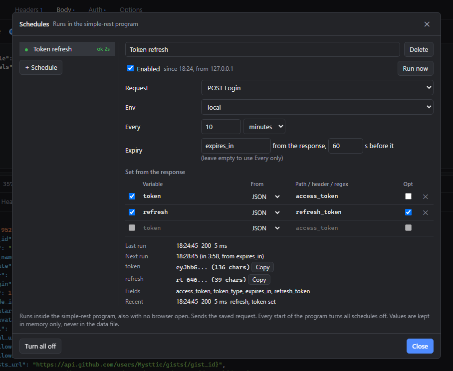

# Schedules

Part of the [simple-rest documentation](../README.md#documentation).

A schedule is a saved request that the program sends every so often to take a value from the
answer, usually a token, and set a variable with it in a chosen environment. The Schedules
button on the top bar opens the schedules window and shows how many of them are on; a red frame
means one of them has stopped, and `?` that the program does not answer.

- **+ Schedule** takes the request open in the editor, as long as it is saved in a collection.
  The ⟳ button next to a request in the sidebar does the same, and the ⟳ mark shows the requests
  that an enabled schedule sends. A new schedule is off: check its rules with Run now first,
  then tick Enabled.
- **Every** is the gap between runs, from 10 seconds to a day. **Expiry** is a JSON path to the
  lifetime in seconds (`expires_in`, for instance): the program refreshes the value as many
  seconds before it expires as you give, but never less often than Every. An empty field leaves
  Every alone.
- **Set from the response** holds the rules: a JSON path (`access_token`,
  `data.items[0].token`, optionally with `$.`), a header name, or a regular expression in Go
  syntax (RE2, without lookbehind and backreferences; the value is the first group). A rule
  marked Opt may find nothing. When a required rule finds nothing, the run sets nothing.
- The value goes into an overlay in the program's memory. In its environment it wins over the
  table, even over a disabled row, and it also works for a name the table does not have. The
  Environments window shows it under the table, with Copy and Clear buttons. Requests see it
  only in a tab that has that environment selected.
- Before Send and before cURL the tab saves its changes and asks the program for fresh values of
  the variables the request uses (25 seconds at most). When a value may be stale or is missing,
  because its schedule is off, has stopped or has failed, a notification says so plainly, and the
  request goes out anyway.
- A rejected login (401, 403), a redirect and any other 4xx answer stop the schedule after the
  first attempt, so that the account does not get locked. 5xx, 408 and 429 are retried less and
  less often, and the fifth failure in a row stops the schedule too. Run now after a fix lifts
  the stop.
- A schedule sends the version of the request saved in the collection, not the unsaved changes
  in the editor.
- Schedules run in the program, also with no tab open, but only while the program runs. Every
  start of the program, an update included, turns all schedules off and clears the overlay, and
  the values never reach the data file, an export or the history.
