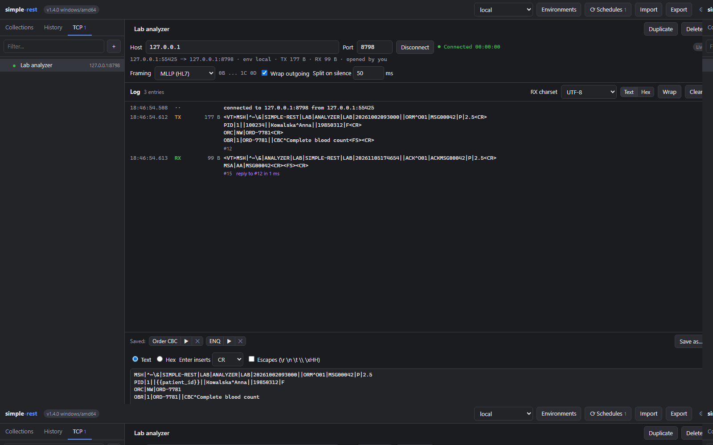

# TCP console

Part of the [simple-rest documentation](../README.md#documentation).

The TCP console (the TCP tab in the sidebar) keeps a TCP connection open to a device or system
on the network, a laboratory analyser for instance, sends messages and shows what comes in. The
program works only as a client: it connects to the host and port you give and never listens.
The counter on the tab shows the open connections.

- **A connection** is a definition in the data file: a name, Host and Port (both may contain
  `{{variables}}`, such as `{{lab_host}}`), the framing and the editor settings. Host is a name,
  an IPv4 address or an IPv6 address (with or without brackets, also with a zone, such as
  `fe80::1%eth0`). A pasted `tcp://10.0.0.5:2575` or `10.0.0.5:2575` is split into host and port.
  Connect stays disabled while the host or port variable has no value or the port is not a
  number from 1 to 65535.
- **The connection's environment.** Connect takes the environment selected in that tab, and the
  connection keeps it until it is disconnected: the program substitutes the variables in the
  messages from that environment (the rows from the file and, over them, the values from the
  schedules), whoever sends and whatever environment their tab has. A tab with another
  environment sees a hint, and changing the connection's environment takes Disconnect and
  Connect. Before Connect and before Send the tab saves its changes and asks the program for
  fresh values from the schedules, as before an HTTP Send.
- **Framing**: None (the default, raw bytes), LF, CR LF, MLLP (HL7, `0B` ... `1C 0D`) and
  STX/ETX (`02` ... `03`). Wrap outgoing adds the frame to the message being sent, unless the
  message has it already. What comes in is split into messages by the frame, and bytes outside a
  frame (an ACK or a NAK, for instance) go to the log on their own, marked `outside frame`. Split
  on silence (with None, MLLP and STX/ETX) closes such an entry after the given silence in
  milliseconds; 0 gives one entry per read. An unclosed frame waits for its end whatever the
  silence, and a frame over 1 MB is cut. A framing change on an open connection takes effect
  after Reconnect.
- **The message editor.** In Text mode the message goes out as UTF-8, Enter inserts the chosen
  line ending (LF, CR or CR LF; HL7 uses CR), and with Escapes on, `\r`, `\n`, `\t`, `\\` and
  `\xHH` give their bytes (`\xHH` exactly one byte). Any other backslash, such as `\&` in an HL7
  header, stays as it is. In Hex mode the message is hex digits, and spaces and new lines do not
  matter. `{{variable}}` works in both modes. The `Sends:` line shows the bytes that will go on
  the wire, with the variables of the connection's environment and with the frame; a variable
  without a value goes out literally as `{{name}}`. A message may be 1 MB at most.
- **Saved messages.** Save as… (Ctrl+S) saves the message from the editor with the connection,
  in the data file. The button with its name puts it into the editor, and ▶ sends it at once.
  The current text of the editor is a draft in this browser (localStorage) and does not go to
  the file.
- **Wait for reply** waits for an answer: the answer is the first entry that started to arrive
  after the send. The outcome is `Reply in 59 ms`, `No reply within 5 s` or
  `Connection closed while waiting`. While it waits, nobody sends another message to that
  connection, and Cancel ends the wait. Waiting does not hold the browser's HTTP connection.
- **The log** shows the sent (TX) and received (RX) messages with time, size and number, as text
  with the names of the control characters (`<VT>`, `<CR>`, `<FS>`) or as hex. RX charset picks
  the encoding the incoming data is shown in (UTF-8, Windows-1250, ISO-8859-2, Latin-1). An entry
  has Copy, Copy escaped and To editor buttons; the last one puts into the editor the template of
  a sent message, or the bytes of a received one without the frame. The times come from the
  clock of the machine with the binary. The log keeps at most 1000 entries or 2 MB per
  connection, in the program's memory only: it does not go to the file, the history or an
  export, and Clear clears it for everyone.
- **Shared connections.** Connections live in the program and are shared by all tabs and
  computers: everyone sees the same log, and an entry sent from another computer is marked
  `by <address>`. A connection stays open after the tabs are closed, until someone presses
  Disconnect, so a device that takes a single client stays busy until then. Connect on an open
  connection ends with `Already connected (another tab or computer?)`.
- A dead device with no traffic is detected by keepalive after about 30 seconds, and on Linux
  also with data in flight (`TCP_USER_TIMEOUT`). On Windows a very slow receiver of a large
  message (over about 400 KB, slower than about 6 KB/s) can end the send with the error
  `write timeout: no progress for 10 s`.
- After every start of the program, an update included, no connection is open and nothing
  connects by itself. The Linux builds do not resolve `.local` names (mDNS): on `no such host`
  the console suggests giving the IP address.

A tab gets the changes to the connections, the log, the data file and the schedules at once,
through one event stream (`GET /api/events`); the Live mark in the console says the stream
works. A tab in the background closes the stream and catches up when you come back. Without the
stream, during a restart of the program for instance, the tab asks the program every few
seconds, and the editor shows `Live updates are off: values may be stale.`
